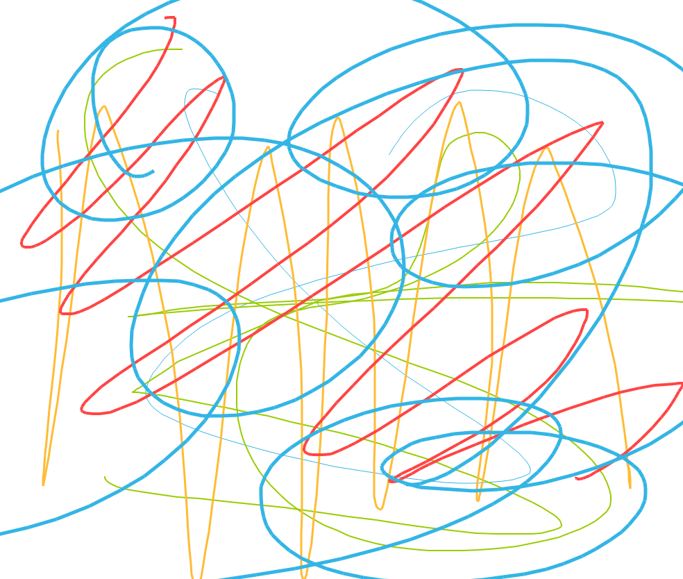

# Лабораторные работы по OPGIPC

## Выполнил Морозов Александр
## Студент группы 6231-010402D

Отчёт по лабораторным работам 1–4. Язык — Python 3, GUI — PyQt5 (в ЛР4 — PyQt5 + QML).

| ЛР | Тема | Папка          | Запуск |
| --- | --- |----------------| --- |
| 1 | Окно, надпись, кнопки, изображение, форма окна | [`lr_1`](lr_1) | `python lr_1.py` |
| 2 | Сигналы и слоты: конвертер валют | [`lr_2`](lr_2) | `python main.py` |
| 3 | Таблицы и SQL (SQLite) | [`lr_3`](lr_3) | `python lr_3.py` |
| 4 | Painter (PyQt5 + QML): сохранение Canvas по таймеру | [`lr_4`](lr_4) | `python main.py` |

## Лабораторная работа №1

### Задание

Создать на PyQt5 окно с надписью и кнопками.

- Кнопка 1: по нажатию надпись меняется на изображение.
- Кнопка 2: окно меняет форму за счёт полупрозрачной картинки (изображение с альфа-каналом).

### Описание программы

Файл: [`lr_1/lr_1.py`](lr_1/lr_1.py). Используются PyQt5, OpenCV и NumPy.

Окно — класс `Window(QWidget)`: сверху надпись `QLabel`, снизу в ряд «Кнопка 1» и «Кнопка 2».

**Кнопка 1** (`on_button1`). Если в надписи текст, функция `make_image()` рисует средствами OpenCV картинку с домиком: стены, крыша, дверь, окна, трава, солнце. Массив OpenCV переводится в `QImage`, затем в `QPixmap` и ставится в надпись. Повторное нажатие возвращает текст «Надпись».

**Кнопка 2** (`on_button2`). Функция `make_shape()` генерирует полупрозрачную картинку с альфа-каналом (BGRA): синий треугольник с чёрным контуром, вне треугольника полная прозрачность. Окно становится безрамочным, `setMask()` обрезает его по непрозрачной части картинки, и окно становится треугольным. `setWindowOpacity(0.8)` делает окно слегка прозрачным, а отступы раскладки сдвигают надпись и кнопки внутрь треугольника. Повторное нажатие возвращает обычное прямоугольное окно.

| Элемент | Назначение |
| --- | --- |
| `make_image()` | рисует домик средствами OpenCV |
| `make_shape(w, h)` | создаёт полупрозрачный треугольник (BGRA) |
| `on_button1()` | меняет надпись на изображение и обратно |
| `on_button2()` | меняет форму окна и обратно |
| `paintEvent()` | рисует картинку-форму в окне |

### Вывод

Создано окно PyQt5 с обработкой нажатий кнопок через сигнал `clicked`. Освоены замена содержимого `QLabel` на изображение, генерация картинок средствами OpenCV и изменение формы окна по альфа-каналу полупрозрачного изображения.

---

## Лабораторная работа №2

### Задание

Тема — сигналы и слоты PyQt5. На основе макета `l2discuss` (файлы `main.py`, `cl1.py`, `cl2.py`) сделать окно с полями ввода курсов рубль, доллар и евро: при изменении одного поля остальные пересчитываются.

### Описание программы

Конвертер валют с тремя полями ввода: «Рубли», «Доллары», «Евро». Изменение любого поля пересчитывает два других через собственные сигналы и слоты.

| Файл | Содержимое |
| --- | --- |
| [`lr_2/main.py`](lr_2/main.py) | окно `Some(QMainWindow)`, класс `Data` с курсами, слоты пересчёта |
| [`lr_2/cl1.py`](lr_2/cl1.py) | класс `Rub(QObject)` с сигналом `mySignal = pyqtSignal(float)` |
| [`lr_2/cl2.py`](lr_2/cl2.py) | класс `Dollar(QObject)` с таким же сигналом |
| [`lr_2/cl3.py`](lr_2/cl3.py) | класс `Euro(QObject)` с таким же сигналом |

Курсы хранятся в `Data.myData` как число единиц валюты в 1 долларе: доллар 1, рубль 90, евро 0.92.

Как проходит пересчёт:

1. Пользователь меняет поле — срабатывает встроенный сигнал `textEdited`.
2. Метод `onEdited` переводит текст в число и отправляет сигнал этой валюты (`emit`).
3. Слот `updateOthers` получает значение, переводит его в доллары и записывает результат в остальные поля.

`textEdited` срабатывает только на ввод пользователя, поэтому программная запись в поля не вызывает бесконечного цикла пересчёта. Если введено не число, остальные поля очищаются.

Отличия от макета: несуществующие `pyqtSignalRub(int)` и `pyqtSignalDolar(int)` заменены на `pyqtSignal(float)` внутри классов-наследников `QObject`; убран циклический импорт `import main` из `cl1.py` и `cl2.py`; добавлен `cl3.py` для евро.

### Вывод

Освоен механизм сигналов и слотов PyQt5: объявление собственных сигналов через `pyqtSignal`, их отправка через `emit` и подключение к слотам через `connect`. На этом механизме построен конвертер, в котором поля ввода обновляют друг друга без зацикливания.

---

## Лабораторная работа №3

### Задание

Реализовать приложение на PyQt5 с представлением таблиц и работой с SQL (SQLite).

- Меню: Set connection (выбор БД через `QFileDialog` и подключение) и Close connection (очистка и закрытие соединения).
- Сразу после подключения в Tab1 выводится `SELECT * FROM sqlite_master`.
- Кнопка bt1 выполняет выборочный запрос (`SELECT name FROM sqlite_master`), результат — в Tab2.
- Выбор колонки в `QComboBox` отправляет результат запроса в Tab3.
- Кнопки bt2 и bt3 выводят таблицы в Tab4 и Tab5.

### Описание программы

Файлы: [`lr_3/lr_3.py`](lr_3/lr_3.py), тестовая база [`lr_3/test.db`](lr_3/test.db).

Окно — класс `Window(QMainWindow)`. Сверху меню «Menu», под ним кнопки bt1 «SELECT Column», bt2 «Query2», bt3 «Query3» и выпадающий список `QComboBox`, ниже `QTabWidget` с вкладками Tab1–Tab5. В каждой вкладке `QTableView` с моделью `QSqlQueryModel`.

| Элемент | Запрос | Вкладка |
| --- | --- | --- |
| Set connection | `SELECT * FROM sqlite_master` | Tab1 |
| bt1 «SELECT Column» | `SELECT name FROM sqlite_master` | Tab2 |
| QComboBox | `SELECT <колонка> FROM sqlite_master` | Tab3 |
| bt2 «Query2» | `SELECT * FROM <первая таблица базы>` | Tab4 |
| bt3 «Query3» | `SELECT * FROM <вторая таблица базы>` | Tab5 |

**Подключение** (`set_connection`). Пользователь выбирает файл БД, открывается соединение `QSQLITE`, в Tab1 выводится `sqlite_master`. Список колонок для `QComboBox` берётся из результата этого запроса, список таблиц для bt2 и bt3 — запросом к `sqlite_master` с фильтром `type = 'table'`. Если выбран не файл SQLite, выводится ошибка и соединение закрывается.

**Закрытие** (`close_connection`). Сначала очищаются модели всех вкладок и список, затем закрывается соединение. Объект соединения создаётся один раз при запуске окна и живёт до конца работы программы: удаление соединения через `removeDatabase()` оставляло моделям ссылку на удалённый драйвер и приводило к вылету при повторном подключении.

**Запросы** (`show_query`, `show_table`). Запрос выполняется в модели нужной вкладки, вкладка становится активной. Ошибка SQL выводится в `QMessageBox`. Без открытого соединения кнопки выводят сообщение «Нет соединения». При закрытии окна соединение закрывается в `closeEvent`.

**Тестовая база** `test.db`: три таблицы (`students`, `courses`, `grades`) и два индекса. После подключения Tab1 показывает 5 строк `sqlite_master`, bt2 выводит таблицу `students`, bt3 — `courses`.

### Вывод

Освоена работа с SQLite из PyQt5 через модуль QtSql: подключение `QSqlDatabase`, выполнение запросов через `QSqlQueryModel` и вывод результатов в `QTableView` на вкладках `QTabWidget`. Учтён жизненный цикл соединения: модели очищаются до закрытия базы, чтобы повторное подключение работало без вылетов.

---

## Лабораторная работа №4

### Задание

Взять каркас `lab4_template` — приложение-рисовалку painter с backend на PyQt5 и frontend на QML. В классе `Interface` реализовать сохранение области рисования `Canvas` по таймеру в файл на носителе информации.

### Описание программы

Файлы: [`lr_4/main.py`](lr_4/main.py), [`lr_4/mainWindow.qml`](lr_4/mainWindow.qml), [`lr_4/Circle.qml`](lr_4/Circle.qml), [`lr_4/Square.qml`](lr_4/Square.qml).

Frontend на QML отвечает за интерфейс и рисование, backend на Python (класс `Interface`) каждые 5 секунд сохраняет рисунок в файл `canvas.png`. QML-файлы каркаса не изменялись.

**Frontend (QML).** `mainWindow.qml` — окно 1000×1000 с панелью инструментов и областью рисования `Canvas`. На панели четыре цвета (компонент `Square.qml`) и пять толщин линии (компонент `Circle.qml`). Рисование ведётся мышью через `MouseArea`.

**Backend (`Interface` в `main.py`).** Объект передаётся в QML как `_backend`. После загрузки QML вызывается `interface.start()`.

| Метод | Что делает |
| --- | --- |
| `start(window)` | находит Canvas в окне и запускает `QTimer` |
| `find_canvas(item)` | рекурсивно обходит элементы окна, ищет наследника `QQuickCanvasItem` |
| `save_canvas()` | по таймеру вызывает у Canvas метод `save(filename)` через `QMetaObject.invokeMethod` |

Canvas ищется через `inherits("QQuickCanvasItem")`, а не по точному имени класса: у Canvas в QML объявлены свои свойства (`lastX`, `lastY`, `color`), поэтому QML создаёт производный класс с именем вида `QQuickCanvasItem_QML_5`.

Интервал и имя файла задаются константами `SAVE_INTERVAL_MS = 5000` и `SAVE_FILE = "canvas.png"`. Файл каждый раз перезаписывается, путь к нему выводится в консоль.

**Проверка.** Нарисовать что-нибудь, через 5 секунд в консоли появится «Canvas сохранён: …/canvas.png». Пример сохранённого файла:

### Вывод

Освоено взаимодействие backend на PyQt5 с frontend на QML: передача объекта в QML через `setContextProperty`, поиск QML-элемента из Python по дереву объектов и вызов его методов через `QMetaObject.invokeMethod`. Сохранение рисунка по `QTimer` реализовано полностью на стороне Python, без изменения QML-каркаса.
