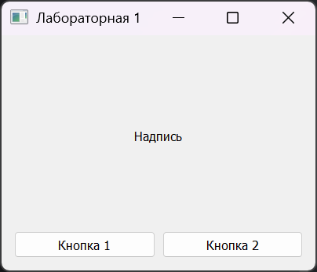
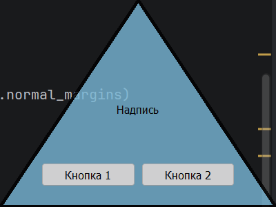
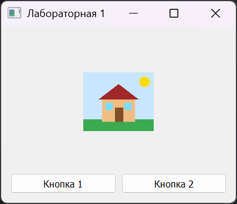
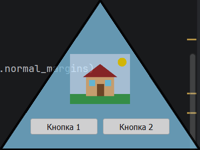
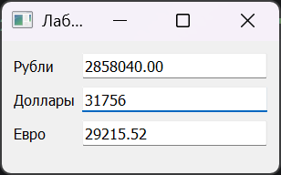
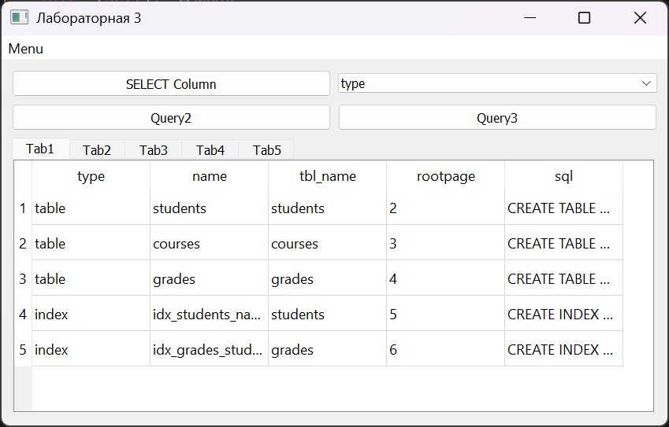
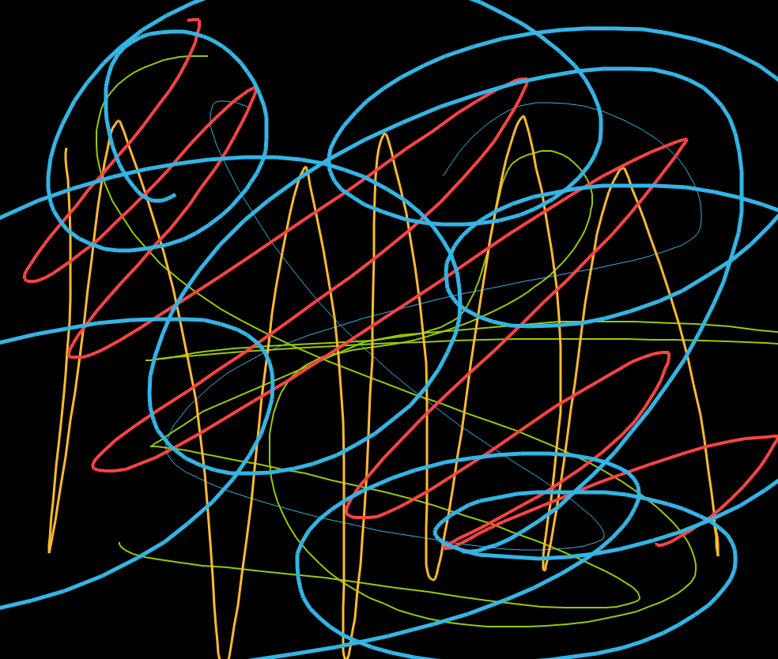

# Лабораторные работы по OPGIPC

## Выполнил: Морозов Александр, студент группы 6231-010402D

---

| ЛР | Тема | Запуск |
| --- | --- | --- |
| [1](lr_1) | Окно, кнопки, изображение, форма окна | `python lr_1.py` |
| [2](lr_2) | Сигналы и слоты: конвертер валют | `python main.py` |
| [3](lr_3) | Таблицы и SQL (SQLite) | `python lr_3.py` |
| [4](lr_4) | Painter на QML: сохранение рисунка по таймеру | `python main.py` |

---

## ЛР1. Окно, кнопки и форма окна

**Задание:** сделать окно с надписью и двумя кнопками. Первая кнопка меняет надпись на изображение, вторая меняет форму окна с помощью полупрозрачной картинки.

**Как работает:**

- **Кнопка 1** меняет надпись на картинку с домиком и обратно. Домик рисуется средствами OpenCV в функции `make_image()`, затем переводится в `QPixmap` и ставится в `QLabel`.
- **Кнопка 2** делает окно треугольным. Функция `make_shape()` создаёт полупрозрачную картинку с альфа-каналом: треугольник внутри, полная прозрачность снаружи. Окно становится безрамочным, `setMask()` обрезает его по форме треугольника, а `setWindowOpacity(0.8)` делает слегка прозрачным.
- Повторное нажатие кнопки 2 возвращает обычное прямоугольное окно.

| Обычное окно | Треугольное окно |
| :---: | :---: |
|  |  |
|  |  |

## ЛР2. Сигналы и слоты

**Задание:** на основе макета `l2discuss` сделать окно с полями курсов рубль, доллар и евро. При изменении одного поля остальные должны пересчитываться.

**Как работает:**

1. Пользователь вводит число в любое поле, и срабатывает встроенный сигнал `textEdited`.
2. Метод `onEdited` отправляет (`emit`) сигнал этой валюты. Сигналы объявлены в отдельных файлах: `Rub` в `cl1.py`, `Dollar` в `cl2.py`, `Euro` в `cl3.py`, у каждого `pyqtSignal(float)`.
3. Слот `updateOthers` переводит сумму через доллар и записывает результат в два других поля.

Курсы хранятся в классе `Data`: 1 доллар = 90 рублей = 0.92 евро. Сигнал `textEdited` срабатывает только на ввод с клавиатуры, поэтому программное обновление полей не зацикливает пересчёт.

## ЛР3. Таблицы и SQL

**Задание:** сделать приложение для просмотра базы SQLite с меню подключения, кнопками запросов, выпадающим списком и вкладками Tab1–Tab5.

**Как работает:**

- **Menu → Set connection** открывает выбор файла БД и подключается к нему. **Close connection** очищает все вкладки и закрывает соединение.
- В каждой вкладке находится `QTableView` с моделью `QSqlQueryModel`. Результат запроса сразу отображается в виде таблицы.
- Если выбрать файл, который не является базой, или нажать кнопку без подключения, программа покажет сообщение об ошибке.

| Элемент | Что выводит | Вкладка |
| --- | --- | --- |
| Подключение | `SELECT * FROM sqlite_master` | Tab1 |
| SELECT Column | `SELECT name FROM sqlite_master` | Tab2 |
| Список колонок | выбранная колонка `sqlite_master` | Tab3 |
| Query2 / Query3 | первая / вторая таблица базы | Tab4 / Tab5 |

Для проверки в папке лежит `test.db` с таблицами `students`, `courses` и `grades`.

## ЛР4. Сохранение Canvas по таймеру

**Задание:** в готовом каркасе рисовалки (backend на PyQt5, frontend на QML) реализовать в классе `Interface` сохранение области рисования в файл по таймеру.

**Как работает:**

- Интерфейс рисовалки описан в QML: панель с выбором цвета (`Square.qml`) и толщины линии (`Circle.qml`), а также область рисования `Canvas`.
- После загрузки QML метод `start()` находит Canvas среди элементов окна и запускает `QTimer`.
- Каждые 5 секунд метод `save_canvas()` вызывает у Canvas встроенный метод `save()`, и рисунок записывается в `canvas.png`. Путь к файлу выводится в консоль.
- Вся логика написана на Python, QML-файлы каркаса не изменялись.

Пример сохранённого файла:

